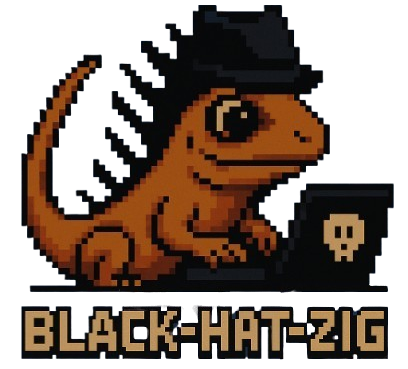

  

    
🌐 Language

    

      

        
<a href="https://openaitx.github.io/view.html?user=CX330Blake&project=Black-Hat-Zig&lang=en">English</a>

        
<a href="https://openaitx.github.io/view.html?user=CX330Blake&project=Black-Hat-Zig&lang=zh-CN">简体中文</a>

        
<a href="https://openaitx.github.io/view.html?user=CX330Blake&project=Black-Hat-Zig&lang=zh-TW">繁體中文</a>

        
<a href="https://openaitx.github.io/view.html?user=CX330Blake&project=Black-Hat-Zig&lang=ja">日本語</a>

        
<a href="https://openaitx.github.io/view.html?user=CX330Blake&project=Black-Hat-Zig&lang=ko">한국어</a>

        
<a href="https://openaitx.github.io/view.html?user=CX330Blake&project=Black-Hat-Zig&lang=hi">हिन्दी</a>

        
<a href="https://openaitx.github.io/view.html?user=CX330Blake&project=Black-Hat-Zig&lang=th">ไทย</a>

        
<a href="https://openaitx.github.io/view.html?user=CX330Blake&project=Black-Hat-Zig&lang=fr">Français</a>

        
<a href="https://openaitx.github.io/view.html?user=CX330Blake&project=Black-Hat-Zig&lang=de">Deutsch</a>

        
<a href="https://openaitx.github.io/view.html?user=CX330Blake&project=Black-Hat-Zig&lang=es">Español</a>

        
<a href="https://openaitx.github.io/view.html?user=CX330Blake&project=Black-Hat-Zig&lang=it">Itapano</a>

        
<a href="https://openaitx.github.io/view.html?user=CX330Blake&project=Black-Hat-Zig&lang=ru">Русский</a>

        
<a href="https://openaitx.github.io/view.html?user=CX330Blake&project=Black-Hat-Zig&lang=pt">Português</a>

        
<a href="https://openaitx.github.io/view.html?user=CX330Blake&project=Black-Hat-Zig&lang=nl">Nederlands</a>

        
<a href="https://openaitx.github.io/view.html?user=CX330Blake&project=Black-Hat-Zig&lang=pl">Polski</a>

        
<a href="https://openaitx.github.io/view.html?user=CX330Blake&project=Black-Hat-Zig&lang=ar">العربية</a>

        
<a href="https://openaitx.github.io/view.html?user=CX330Blake&project=Black-Hat-Zig&lang=fa">فارسی</a>

        
<a href="https://openaitx.github.io/view.html?user=CX330Blake&project=Black-Hat-Zig&lang=tr">Türkçe</a>

        
<a href="https://openaitx.github.io/view.html?user=CX330Blake&project=Black-Hat-Zig&lang=vi">Tiếng Việt</a>

        
<a href="https://openaitx.github.io/view.html?user=CX330Blake&project=Black-Hat-Zig&lang=id">Bahasa Indonesia</a>

      

    

  

# Black-Hat-Zig

  
  
  
  

  <a href="#intro">Intro</a> •
  <a href="#why-zig">Why Zig?</a> •
  <a href="#usage">Usage</a> •
  <a href="#contributors">Contributors</a> •
  <a href="#credits--references">Credits & References</a> •
  <a href="#star-history">Star History</a> •
  <a href="#disclaimer">Disclaimer</a>

  
   
  <b>Hello hackers. Hello maldevs. Hello reversers. Nice to see you here to explore the dark power of Zig!</b>  
  <b>Maintained and managed by <a href="https://github.com/cx330blake">@CX330Blake</a></b>

---

## Intro

> [!IMPORTANT]
> This project is continuously updating!

This project provides many malware techniques implementation using Zig since I'm a huge fan of it. You can use this repo to weaponize Zig. Black-Hat-Zig is continuously updating to make sure it contains as more content as it could. It will be perfect if you want to create a PR for this project.

Okay, let's hack the planet!

## Why Zig?

- 🤝 Easy to interact with C/C++ source
- 🔎 It's newer, so it's harder to be detect
- 💪 Strongly low level control, even lower than C
- 😱 It's harder to RE because of the modern compiler
- 🛡️ Minimal runtime dependencies - No massive standard library footprint
- 🎯 No undefined behavior - Explicit handling of edge cases prevents crashes

## Usage

- [Quick Start](https://black-hat-zig.cx330.tw)

## Contributors

This project is mainly maintained & managed by [@CX330Blake](https://github.com/CX330Blake). PRs are welcomed. Hope there's more people use Zig for malware developing so the ecosystem will be more mature.

Huge thanks for these contributors!

## Credits & References

- [Maldev Academy](https://maldevacademy.com/)
- [OffensiveNim](https://github.com/byt3bl33d3r/OffensiveNim)

## Star History

## Disclaimer

This project is for ethical and educational purpose only. Don't be a cyber criminal.

<!-- GitAds-Verify: SYUFFUKR39H8T8MYYOIUKQ5AFB1O8AQ9 -->

## GitAds Sponsored

  This project is <strong>sponsored by <a href="https://docs.gitads.dev/docs/getting-started/publishers">GitAds</a></strong>. 
  You can get your GitHub repository sponsored too — <a href="https://docs.gitads.dev/docs/getting-started/publishers">create your account now</a>.

